# Users + Orders: два микросервиса и автотесты API


Учебное решение на наработках курса «Интеграционное тестирование»: FastAPI, хранение в памяти, pytest + `requests`, Postman/Newman.

Два сервиса:

| Сервис | Порт | Назначение |
|---|---|---|
| Users API | `8001` | Создание и получение пользователя |
| Orders API | `8002` | Создание и получение заказа; при этом запрашивает пользователя в Users API по `user_id` |

```
клиент ──► Orders API ──HTTP GET /api/v1/users/{id}──► Users API
                │
                └── 201/200 + данные пользователя
                    404 если пользователя нет
                    503 если Users API недоступен
```

Данные живут в памяти процесса: после перезапуска Users API снова отдаёт двух стартовых пользователей, заказов нет.

## Структура

```
users_service/app/     REST Users API
orders_service/app/    REST Orders API + HTTP-клиент к Users API
tests/                 pytest: CRUD, успех межсервисного вызова, 503, время отклика
postman/               коллекция и окружение для Postman / Newman
openapi/               выгруженные спецификации OpenAPI 3.1
docs/                  скриншоты Swagger UI
scripts/               запуск обоих сервисов и выгрузка OpenAPI
```

## Быстрый старт

Python 3.12+ и Node.js 18+ (Node — только для Newman).

```bash
make install     # создаст .venv и поставит зависимости
make run         # Users :8001, Orders :8002
```

В другом терминале:

```bash
make test        # pytest; если сервисы не запущены, тесты поднимут их сами
make newman      # Postman-коллекция через Newman
make check       # pytest + newman
make openapi     # обновить openapi/users.json и openapi/orders.json
```

Swagger UI:

- Users API — http://127.0.0.1:8001/docs
- Orders API — http://127.0.0.1:8002/docs

В Postman импортируйте `postman/user_order.postman_collection.json` и `postman/local.postman_environment.json`.

Порты и токен меняются переменными окружения: `USERS_PORT=9001 ORDERS_PORT=9002 make run`. Тестам передайте те же `USERS_PORT`, `ORDERS_PORT` или `USERS_URL` / `ORDERS_URL`.

## API

Изменяющие запросы требуют `Authorization: Bearer secret-token`. Каждый ответ содержит `X-Request-ID`. Ответы Orders API, которые ходили в Users API, ещё содержат `X-User-Service-Time-Ms` — время межсервисного вызова в миллисекундах.

### Users API — `http://127.0.0.1:8001`

**Swagger: Users API**

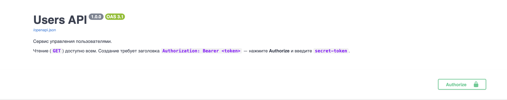

**Авторизация** — кнопка Authorize, токен `secret-token`:

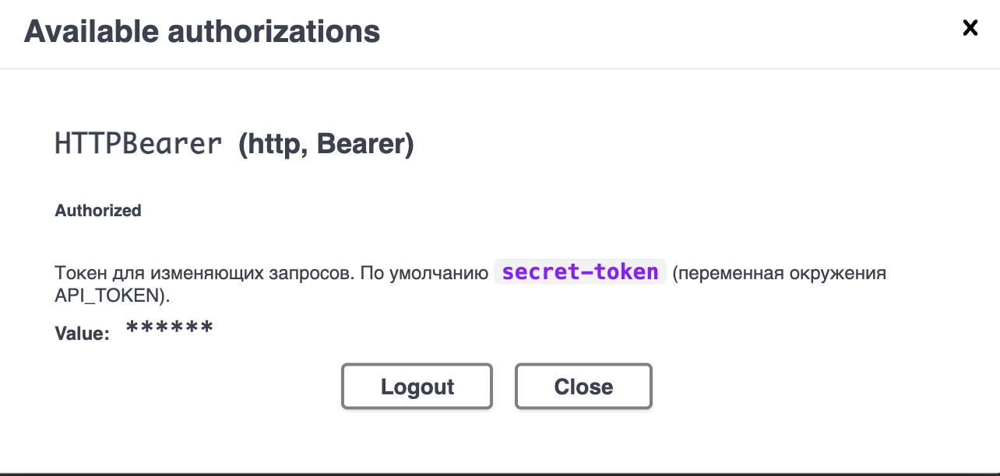

| Метод | Путь | Токен | Успех | Ошибки |
|---|---|---|---|---|
| GET | `/health` | — | 200 | — |
| GET | `/api/v1/users` | — | 200 | — |
| GET | `/api/v1/users/{id}` | — | 200 | 404, 422 |
| POST | `/api/v1/users` | да | 201 + `Location` | 401, 409 — email занят, 422 |

```json
{ "id": 1, "name": "Анна Иванова", "email": "anna@example.com" }
```

`name` — 1–100 символов, не из одних пробелов. `email` нормализуется к нижнему регистру и уникален. Неизвестные поля запрещены. `id` назначает сервер.

**GET `/api/v1/users`** — список пользователей:

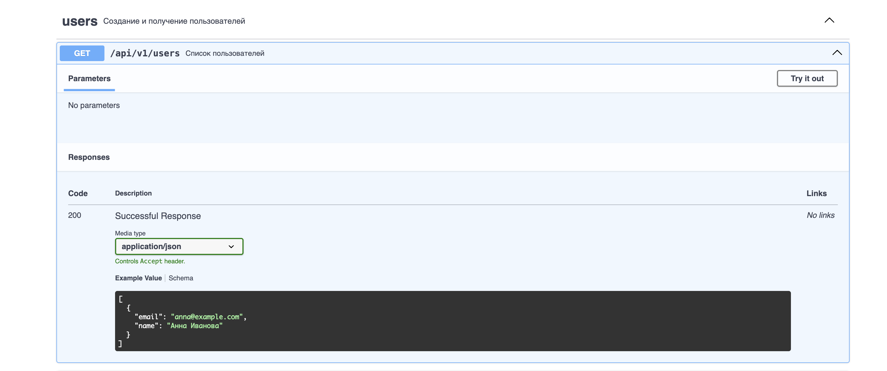

**POST `/api/v1/users`** — создать пользователя. Успех `201`, без токена `401`, занятый email `409`:

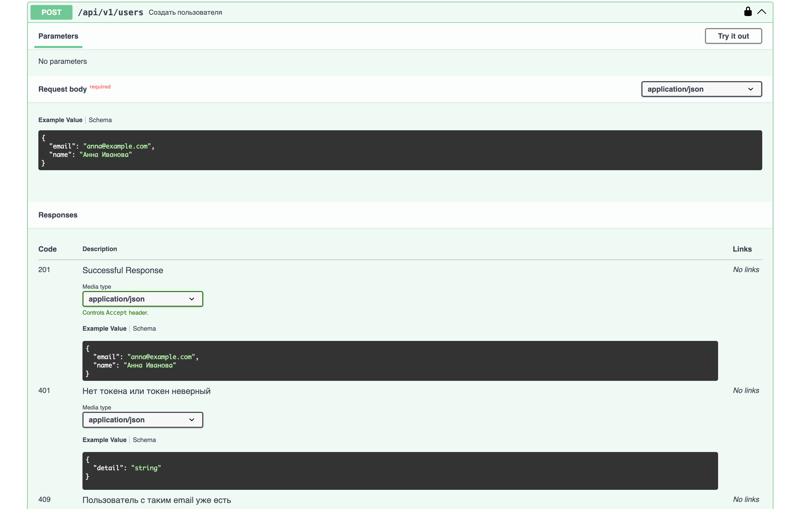

Невалидное тело — `422`:

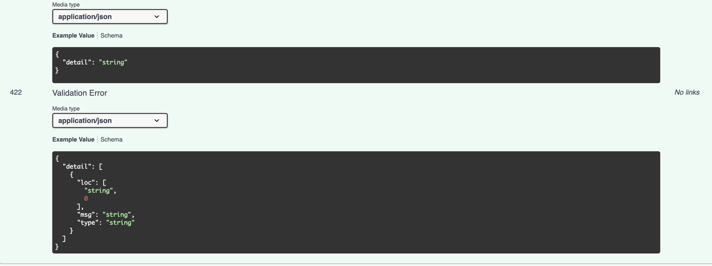

**GET `/api/v1/users/{id}`** — пользователь по id. Успех `200`, нет пользователя `404`:

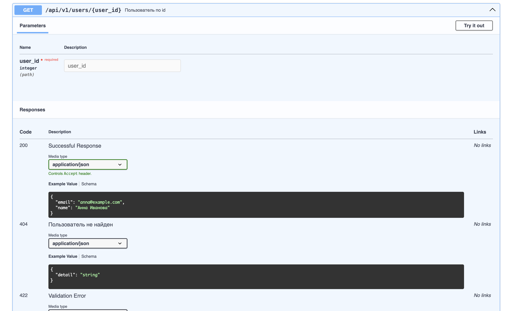

Неверный id — `422`:

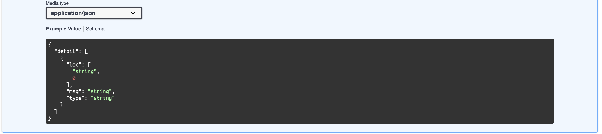

### Orders API — `http://127.0.0.1:8002`

**Swagger: Orders API** — при создании и чтении заказа сервис ходит в Users API; если тот недоступен, будет `503`:

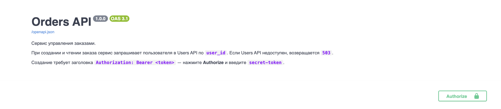

**Авторизация** — тот же Bearer-токен:

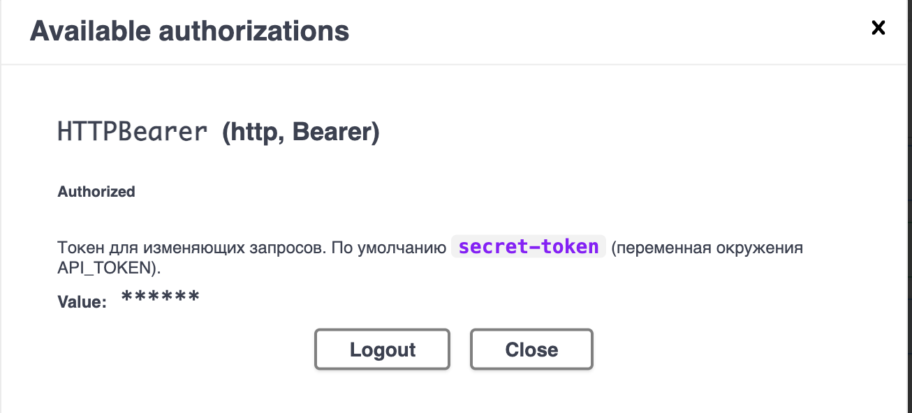

**Эндпоинты** — список, создание (с проверкой пользователя) и заказ по id:

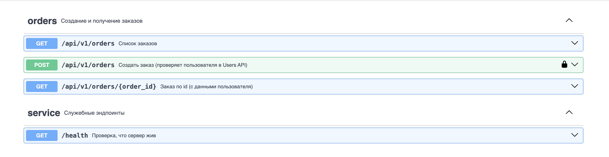

| Метод | Путь | Токен | Успех | Ошибки |
|---|---|---|---|---|
| GET | `/health` | — | 200 | — |
| GET | `/api/v1/orders` | — | 200 | 404 / 503 при запросе пользователя |
| GET | `/api/v1/orders/{id}` | — | 200 | 404, 503 |
| POST | `/api/v1/orders` | да | 201 + `Location` | 401, 404, 422, 503 |

```json
{
  "id": 1,
  "user_id": 1,
  "item": "Настольная лампа",
  "quantity": 2,
  "user": { "id": 1, "name": "Анна Иванова", "email": "anna@example.com" }
}
```

Перед созданием и при чтении заказа сервис вызывает `GET {USER_SERVICE_URL}/api/v1/users/{user_id}`. Адрес Users API задаётся переменной `USER_SERVICE_URL` (по умолчанию `http://127.0.0.1:8001`), таймаут — `USER_SERVICE_TIMEOUT` (по умолчанию 2 секунды).

**GET `/api/v1/orders`** — список заказов, в каждом заказе вложенный `user` из Users API:

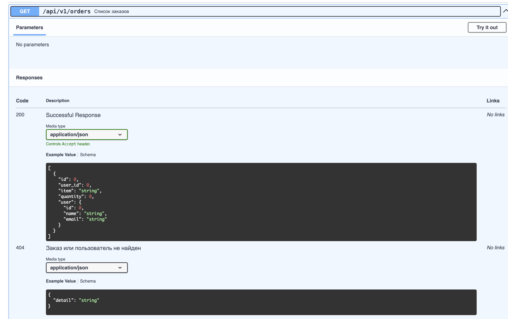

Ошибки списка: пользователя нет — `404`, Users API лёг — `503`:

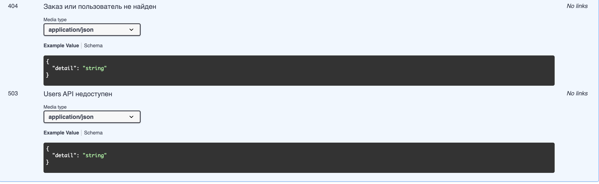

**POST `/api/v1/orders`** — создать заказ. Сервис сначала запрашивает пользователя по `user_id`:

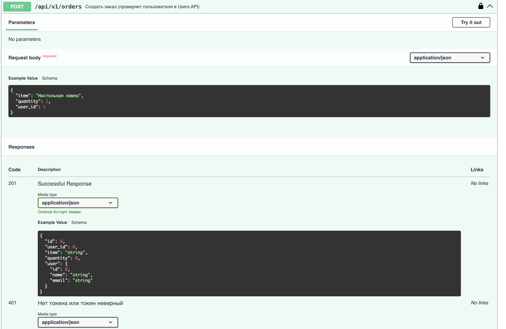

Ошибки создания: пользователя нет — `404`, невалидное тело — `422`, Users API недоступен — `503`:

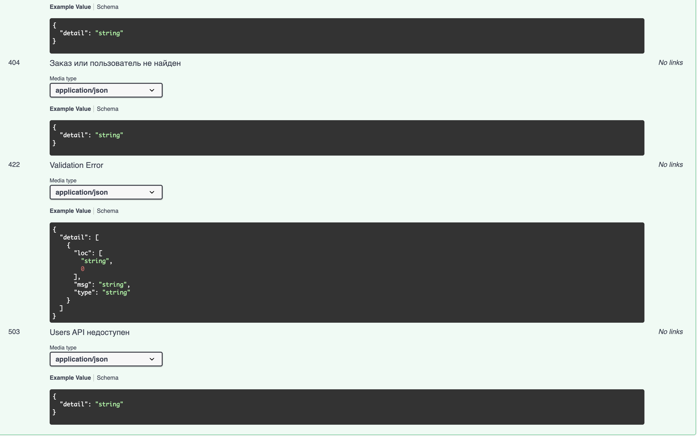

**GET `/api/v1/orders/{id}`** — заказ по id, снова с актуальными данными пользователя:

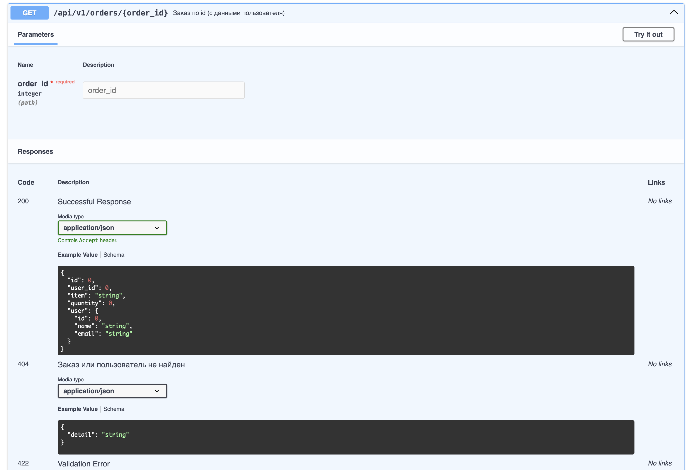

Ошибки чтения: невалидный id — `422`, Users API недоступен — `503`:

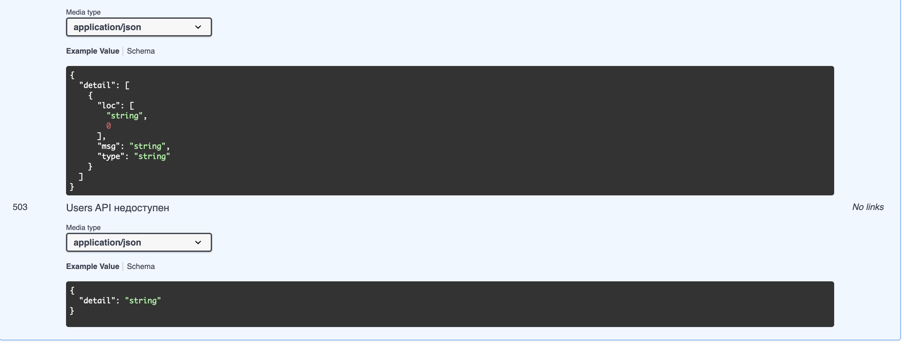

**GET `/health`** — сервис жив:

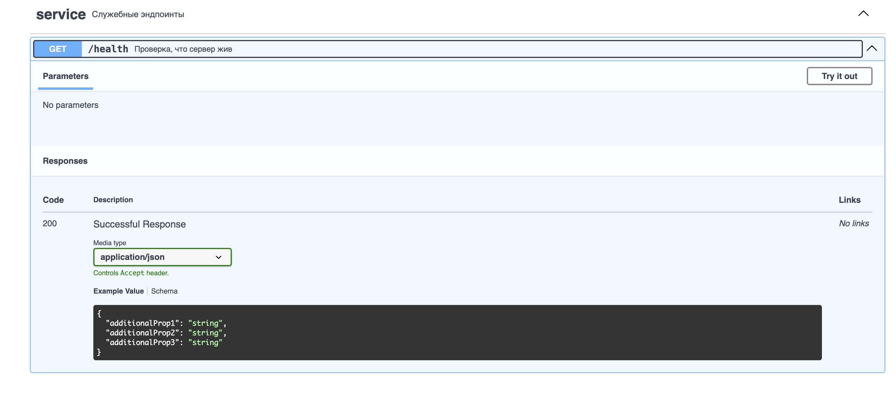

**Схемы** — `Order`, `OrderIn`, `UserSnapshot` и ошибки:

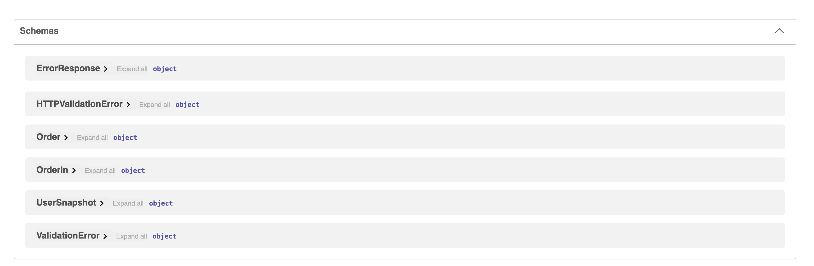

## Сценарии автотестов

Задание закрывают тесты в `tests/test_interservice.py` и одноимённая папка в коллекции Postman.

| Сценарий | pytest | Postman / Newman |
|---|---|---|
| Успех: Orders API получает пользователя по id | `test_orders_service_fetches_user_by_id` | Create order fetches user, Get order refreshes user |
| Users API недоступен → 503, заказ не создаётся | `test_orders_return_503_when_users_service_is_unavailable` | только pytest: поднимается отдельный Orders API с мёртвым `USER_SERVICE_URL` |
| Время отклика межсервисного вызова | `test_user_fetch_response_time_is_within_slo` — `X-User-Service-Time-Ms` < 500 мс | те же запросы: заголовок < 500 мс, весь ответ < 1000 мс |

SLO можно переопределить: `USER_FETCH_SLO_MS=800 make test`.

