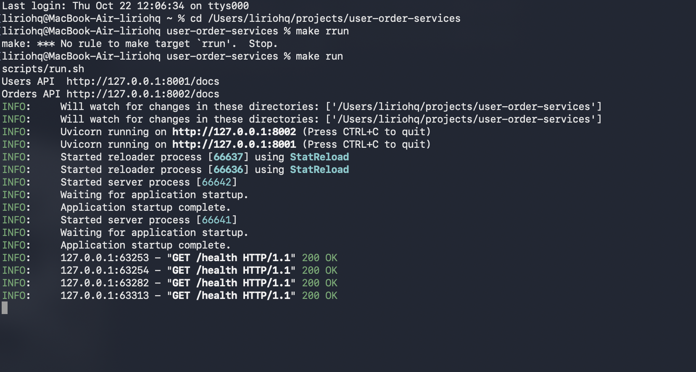
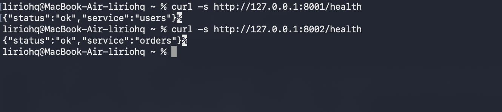
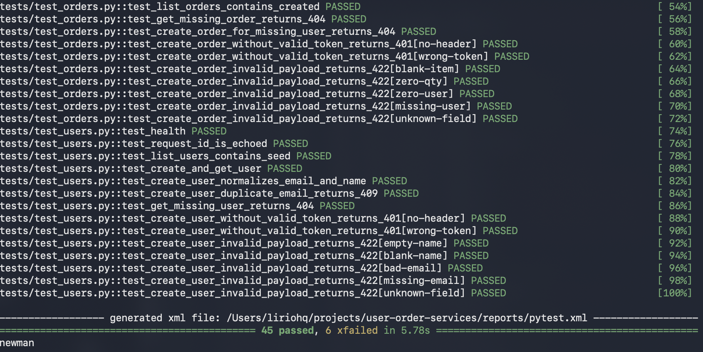
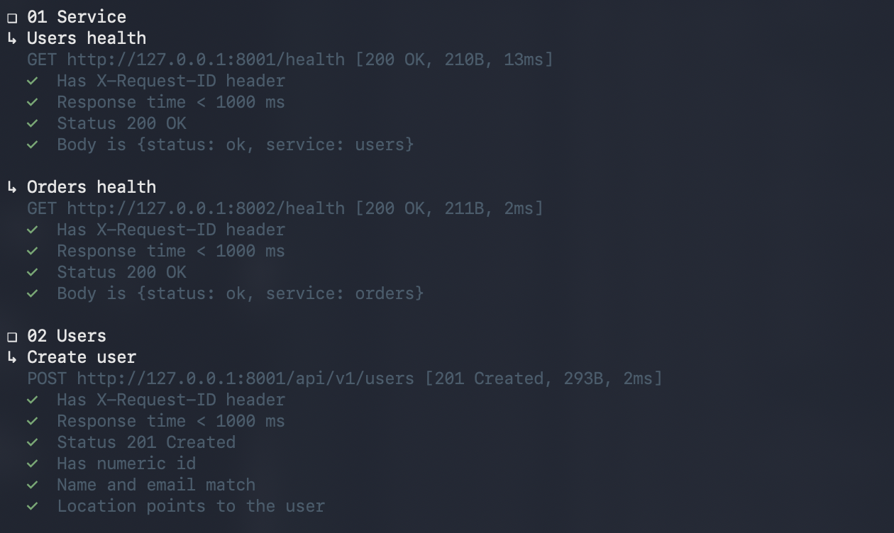
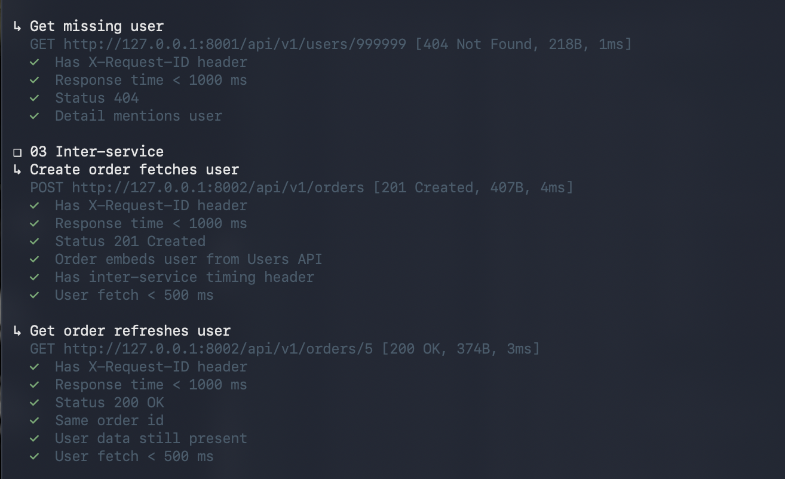
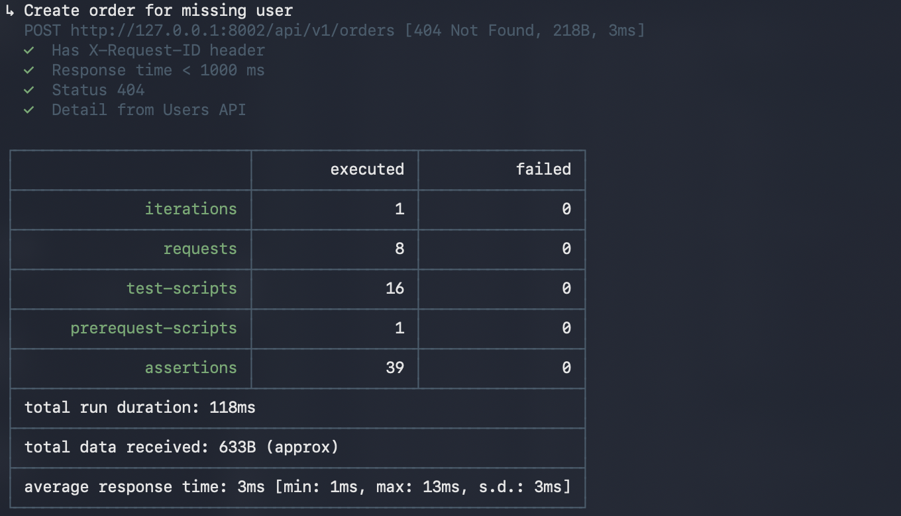
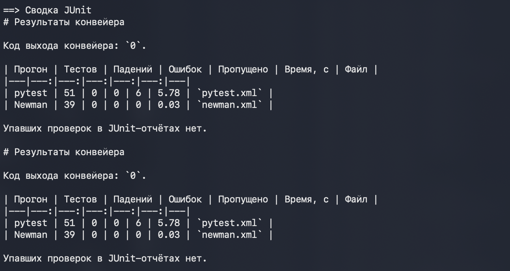

# Отчёт по лабораторной работе

## 1. Что я настраивал

Непрерывная интеграция (CI) здесь значит одно: после изменения кода одни и те же проверки запускаются сами, без ручного `pytest` на своей машине. Если проверка не прошла, сборка красная, и по отчёту видно, какой тест упал.

Непрерывную доставку (CD) в этой работе я ограничил публикацией результатов. Сервисы учебные, данные у них в памяти, выкладывать их на сервер некуда. Конвейер не деплоит приложение. Он всегда сохраняет журналы и JUnit-отчёты, в том числе когда тесты упали. Так результат прогона не пропадает вместе с временной машиной GitHub Actions.

Проект тот же, что в прошлых лабораторных: два сервиса на FastAPI. Users API слушает порт 8001, Orders API — 8002 и при создании или чтении заказа ходит в Users API. Интеграционные тесты уже были: pytest в `tests/` и коллекция Postman, которую гоняет Newman. Конвейер их не заменяет, а запускает целиком при каждом push и pull request.

В репозитории уже лежал черновик `.github/workflows/ci.yml`. Он запускался только для ветки `main`, сам не падал, если сервис не поднялся (цикл ожидания `/health` просто заканчивался), и не собирал короткую сводку. Шаги локального `make check` и шаги Actions могли разъехаться. Я свёл прогон в один скрипт и подключил его и локально, и в GitHub Actions.

## 2. Как устроен конвейер

Файл `.github/workflows/ci.yml` срабатывает на любой `push` и на любой pull request, не только на `main`. Задание на `ubuntu-latest` ставит Python 3.12 и Node.js 22, ставит зависимости из `requirements.txt` и вызывает `bash scripts/ci.sh`. После этого, даже если скрипт завершился с ошибкой, шаг `upload-artifact` кладёт каталог `reports/` и журналы сервисов в артефакт `test-reports`.

Локально та же команда вызывается через `make ci`. Отличие среды только в интерпретаторе: на GitHub это `python` после `setup-python`, у меня в прогоне — `.venv` проекта.

Скрипт `scripts/ci.sh` идёт по шагам и в конце всё равно пишет сводку. Ненулевой код шага сохраняется как код выхода конвейера.

```
push или pull request
        │
        ▼
checkout, Python 3.12, Node.js 22, pip install
        │
        ▼
scripts/ci.sh
  1. выгрузить OpenAPI и сверить с openapi/*.json
  2. поднять Users API :8001 и Orders API :8002
  3. pytest  → reports/pytest.xml
  4. Newman  → reports/newman.xml
  5. сводка  → reports/ci-summary.md
        │
        ▼
артефакт test-reports и текст сводки в журнале задания
```

| Шаг | Где | Что делает | Если не прошёл |
|---|---|---|---|
| Зависимости | workflow | `pip install -r requirements.txt` | задание останавливается, отчётов тестов ещё нет |
| Контракт | `scripts/ci.sh` | `scripts/export_openapi.py` и `git diff --exit-code` по `openapi/users.json` и `openapi/orders.json` | тесты не запускаются, код выхода 1 |
| Сервисы | `scripts/with_servers.sh` | uvicorn для обоих сервисов, ожидание `GET /health` | скрипт завершается с ошибкой и печатает журнал сервиса |
| pytest | `scripts/ci_tests.sh` | весь каталог `tests/`, JUnit из `pytest.ini` | падения пишутся в `reports/pytest.xml`, Newman всё равно запускается |
| Newman | `scripts/ci_tests.sh` | коллекция `postman/user_order.postman_collection.json` | падения пишутся в `reports/newman.xml` |
| Сводка | `scripts/summarize_junit.py` | читает оба XML | пишется даже при падении; на GitHub тот же текст дописывается в `GITHUB_STEP_SUMMARY` |
| Артефакт | workflow, `if: always()` | `reports/`, `users.server.log`, `orders.server.log` | выкладывается и для красной сборки |

Код выхода берётся так. Если упал pytest, конвейер заканчивается его кодом, но Newman к этому моменту уже отработал, и оба XML попадают в сводку. Если pytest прошёл, а Newman нет, кодом выхода становится код Newman. Шаг сверки OpenAPI стоит раньше сервисов: устаревшая спецификация — это тоже красная сборка, просто без прогона HTTP.

Шесть известных дефектов прошлых лабораторных по-прежнему помечены `xfail` (BB-04, BB-05, HY-05, HY-08, HY-09, HY-10). В JUnit pytest записывает их как пропущенные. Для конвейера это не падение: сборка красная только при `failed` или `error`.

## 3. Изменение, на котором я проверил конвейер

Я поменял ответ `GET /health`. Раньше оба сервиса возвращали `{"status": "ok"}`. Теперь в теле есть имя процесса:

```json
{"status": "ok", "service": "users"}
```

```json
{"status": "ok", "service": "orders"}
```

Так по ответу видно, какой сервис поднялся. Схема OpenAPI у этого ответа и раньше была словарём строк, поэтому файлы `openapi/*.json` после выгрузки не изменились, и шаг сверки спецификации прошёл. Зато проверки тела в pytest и в Postman остались старыми. Это как раз тот случай, который конвейер должен поймать.

Ответ проверял так. В одном терминале поднял сервисы, во втором запросил `/health`:

```bash
make run
```



```bash
curl -s http://127.0.0.1:8001/health
curl -s http://127.0.0.1:8002/health
```



## 4. Первый прогон: тесты ещё ждут старое тело

Команду запускал из корня проекта, пока тесты ещё сравнивали тело со старым словарём без `service`:

```bash
make ci
```

Скрипт поднял оба сервиса, прогнал pytest, затем Newman, записал XML и сводку и завершился с кодом 1. `make` из-за этого напечатал `Error 1`. Кадр терминала этого прогона не сохранял: скриншоты ниже сняты уже после правки тестов.

| Прогон | Тестов | Падений | Ошибок | Пропущено | Время, с |
|---|---:|---:|---:|---:|---:|
| pytest | 51 | 4 | 0 | 6 | 5.68 |
| Newman | 39 | 2 | 0 | 0 | 0.03 |

Упали проверки, которые сравнивали тело `/health` со старым словарём без поля `service`:

- `tests/test_users.py::test_health` — в ответе лишнее `service: users`;
- `tests/test_orders.py::test_health` — лишнее `service: orders`;
- `tests/test_big_bang.py::test_bb_01_all_modules_together_happy_path` — то же на портах 28001 и 28002;
- `tests/test_hybrid.py::test_hy_11_health_does_not_touch_the_lower_layer` — то же через тестовый клиент Orders API;
- Newman, запросы `01 Service / Users health` и `01 Service / Orders health`, проверка `Body is {status: ok}`.

Остальные интеграционные сценарии прошли: создание заказа с запросом пользователя, 404 для несуществующего пользователя, 503 при недоступном Users API, время межсервисного вызова, коллекция Postman кроме двух проверок health. Шесть `xfail` остались ожидаемыми пропусками, новых дефектов конвейер не показал.

Сводка `scripts/summarize_junit.py` перечислила эти шесть падений с текстом assertion. Полные трассы остались в `reports/pytest.xml` и `reports/newman.xml`. Значит, красная сборка не только останавливает конвейер, но и оставляет, что именно разошлось с кодом.

## 5. Второй прогон: проверки приведены к новому ответу

Я поправил четыре теста pytest и две проверки в коллекции Postman: ожидаемое тело теперь включает `service`. Код сервисов между прогонами не менялся. Снова из корня проекта:

```bash
make ci
cat reports/ci-summary.md
```











| Прогон | Тестов | Падений | Ошибок | Пропущено | Время, с |
|---|---:|---:|---:|---:|---:|
| pytest | 51 | 0 | 0 | 6 | 5.78 |
| Newman | 39 | 0 | 0 | 0 | 0.03 |

Итог pytest в консоли: `45 passed, 6 xfailed` за 5.78 с. Шесть пропущенных в JUnit — те же известные `xfail`. Newman: 8 запросов, 39 проверок, 0 падений, прогон 118 мс. Код выхода конвейера: 0. В сводке строка «Упавших проверок в JUnit-отчётах нет». На скриншоте сводка напечатана дважды: сначала самим конвейером, затем командой `cat reports/ci-summary.md`.

Оба прогона я выполнил локально, 22 октября 2026, в каталоге проекта. Интерпретатор — `.venv`, Python 3.14.8, pytest 8.3.4, Node.js 26.10.0. Файл workflow на раннере просит Python 3.12 и Node.js 22: это версии из README (`Python 3.12+`, `Node.js 18+`). Коммит в `origin` я не отправлял, поэтому журнал GitHub Actions для этого изменения не открывал. Удалённое задание вызовет тот же `scripts/ci.sh` после `pip install`.

## Вывод

Конвейер запускает интеграционные тесты сам: один скрипт и для `make ci`, и для GitHub Actions на каждый push и pull request. Перед тестами он сверяет OpenAPI с кодом и не идёт дальше, если сервисы не ответили на `/health`. pytest и Newman пишут JUnit, скрипт сводки собирает из них таблицу и список падений, а workflow сохраняет файлы артефактом даже при ошибке.

На изменении `GET /health` это видно по двум прогонам. Пока тесты ждали старое тело, конвейер закончился с кодом 1 и записал 4 падения pytest и 2 падения Newman. После правки ожиданий тот же конвейер закончился с кодом 0: 45 passed и 6 xfailed у pytest, 39 проверок Newman без падений.

## Как запустить

```bash
make install
make run
```

```bash
curl -s http://127.0.0.1:8001/health
curl -s http://127.0.0.1:8002/health
```

```bash
make ci
cat reports/ci-summary.md
```

Сводка появляется в `reports/ci-summary.md`. Рядом лежат `reports/pytest.xml` и `reports/newman.xml`. На GitHub тот же прогон смотрят в Actions, артефакт называется `test-reports`.
