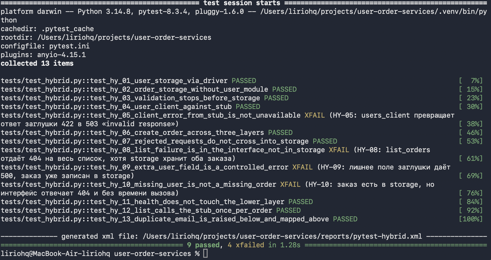
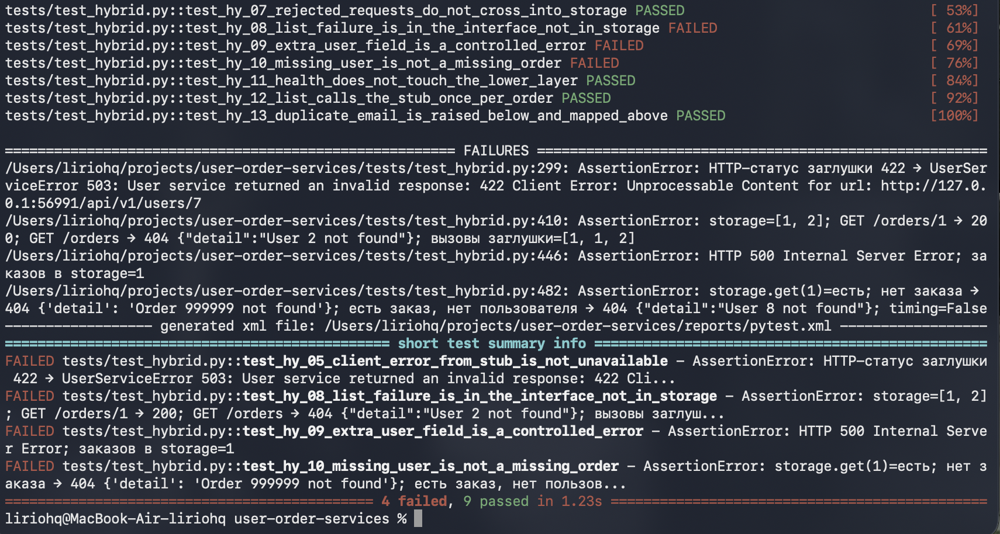

# Отчёт по лабораторной работе

## Интеграционное тестирование гибридным методом

## 1. Что я проверял

Я применил гибридный метод на учебном проекте `user-order-services`, который мы уже делали на курсе. В нём два сервиса на FastAPI: Users API и Orders API. Когда создаётся или читается заказ, Orders API запрашивает пользователя. Данные обоих сервисов лежат в памяти и пропадают после перезапуска.

Отдельного окна или страницы в проекте нет, поэтому интерфейсом я считал HTTP-обработчики в `main.py`. Ниже них идёт проверка данных и правила вызова другого сервиса, ещё ниже — хранилище.

| Слой | Users API | Orders API |
|---|---|---|
| Интерфейс | `users_service/app/main.py` | `orders_service/app/main.py` |
| Бизнес-логика | `models.py`, `auth.py` | `models.py`, `auth.py`, `users_client.py` |
| Доступ к данным | `storage.py` | `storage.py`; снаружи ещё Users API |

Для заказов нижний модуль — это Users API. Я не стал поднимать его в этих тестах и подставил заглушку: иногда функцию с готовым ответом, иногда маленький HTTP-сервер. Так я мог проверять заказы, даже если ответ пользователя ещё не такой, как у готового сервиса.

Схема основного сценария у меня получилась такая:

```
тест → интерфейс Orders → проверка заказа → хранилище заказов
                 │
                 └── заглушка пользователя
```

## 2. Как я проводил тестирование

Тесты лежат в `tests/test_hybrid.py`. Оба сервиса для них запускать не нужно.

Я шёл с двух сторон.

Снизу вверх я сам вызывал хранилище, без HTTP. Это драйвер: тестовый код занимает место верхнего слоя. Так я проверил пользователей и заказы. Заказ с `user_id`, которого нет ни в одном сервисе, всё равно сохраняется. Проверка «такой пользователь есть» живёт выше хранилища.

В середине я вызывал `users_client.get_user` напрямую. Вместо Users API отвечала HTTP-заглушка: 200, 404, 422 или просто закрытый порт.

Сверху вниз я отправлял запросы в маршруты Orders API. Хранилище заказов было настоящим, а `get_user` — заглушкой. После ответа я отдельно смотрел, появилась ли строка в хранилище.

То же самое я сделал для Users API. Драйвер ловит из хранилища `DuplicateEmailError`, а интерфейс в соседней проверке переводит её в ответ 409. Потом я подменил `storage.create` заглушкой, которая всегда бросает эту ошибку, и интерфейс снова ответил 409.

Сначала я взял самые частые действия: создать пользователя, создать заказ, прочитать заказ и список, отсечь заведомо плохой запрос.

| ID | Как проверял | Что проверял | Что ждал |
|---|---|---|---|
| HY-01 | снизу вверх | Хранилище пользователей | стартовые пользователи на месте, имя и email приводятся к нормальному виду, повтор email даёт `DuplicateEmailError` |
| HY-02 | снизу вверх | Хранилище заказов без модуля пользователей | заказ с `user_id=4242` сохраняется, чужой id возвращает пусто |
| HY-03 | логика, потом данные | Невалидный заказ | объект заказа не создаётся, хранилище пустое; нормальная строка сохраняется уже без пробелов по краям |
| HY-04 | середина, заглушка | `users_client` | 200 и тело заглушки, 404 «User not found», обрыв соединения даёт 503, заголовок `X-Request-ID` уходит в заглушку |
| HY-05 | середина, заглушка 422 | Users API отвечает 422 | статус ошибки 422, без подмены на «сервис недоступен» |
| HY-06 | три слоя вместе | Создать и прочитать заказ | 201 и 200, снимок пользователя из заглушки, строка в хранилище, `Location` и `X-Request-ID` |
| HY-07 | сверху вниз | Границы слоёв | 404 заглушки, запрос без токена и неверное тело не оставляют заказ; 401 и 422 до заглушки не доходят |
| HY-08 | сверху вниз | Два заказа, по второму пользователю заглушка отвечает 404 | 200, заказ первого пользователя есть в списке, обе строки остаются в хранилище |
| HY-09 | сверху вниз | Заглушка добавляет в карточку поле `phone` | не 500: либо заказ создан, либо ошибка понятная и строки в хранилище нет |
| HY-10 | сверху вниз | Заказ есть в хранилище, заглушка говорит, что пользователя нет | статус отличается от «заказа нет», в ответе есть время вызова заглушки |
| HY-11 | сверху вниз | `/health`, когда заглушка отвечает отказом | видно, смотрит ли проверка живости на нижний слой |
| HY-12 | сверху вниз | Три заказа одного пользователя | на список — один вызов заглушки, а не по вызову на каждый заказ |
| HY-13 | снизу вверх и сверху вниз | Повтор email в Users API | хранилище бросает `DuplicateEmailError`, интерфейс отвечает 409 и на настоящем хранилище, и на заглушке `create` |

HY-06 для меня основной сценарий. В нём запрос проходит интерфейс, проверку полей, запись в хранилище и чтение обратно. Пользователь при этом целиком приходит из заглушки.

Запускал так:

```bash
make test-hybrid
```

## 3. Результаты прогона

Обычный запуск `make test-hybrid` собрал 13 тестов. Четыре известных дефекта помечены как `xfail` с `strict=True`: если их исправят, pytest перестанет считать падение ожидаемым. Итог этого прогона: `9 passed, 4 xfailed` за 1.28 с.



Чтобы увидеть те же дефекты как обычные падения, я запустил тесты с `--runxfail`. Упали HY-05, HY-08, HY-09 и HY-10. Итог: `4 failed, 9 passed` за 1.23 с.



HY-11 и HY-12 по коду ответа прошли: health отвечает 200, список из трёх заказов читается. Но по счётчику заглушки я увидел проблемы и записал их как аномалии.

Журнал прогона я сохранил в `reports/hybrid-findings.json`.

## 4. Что я нашёл

### Дефект HY-05. Ответ 422 превращается в недоступность сервиса

Слой: бизнес-логика, `orders_service/app/users_client.py`.

Я настроил заглушку так, чтобы `GET /api/v1/users/7` отвечал 422. Клиент заказов отдельно обрабатывает только 404 и коды от 500. Код 422 попал в общую ветку и вышел наружу как ошибка 503 с текстом `User service returned an invalid response: 422 Client Error`.

Интерфейс я в этом тесте не вызывал, бил драйвером прямо в клиент. Поэтому ошибка сидит в `users_client`: любой ответ, кроме 404 и 5xx, вызывающий код увидит как временную недоступность.

Когда я раньше собирал оба сервиса целиком, этого не было видно. Готовый Users API на числовой id отвечает 200 или 404. Ветка 422 появилась только когда я подставил заглушку с другим ответом.

### Дефект HY-08. Список заказов падает целиком

Слой: интерфейс, `list_orders` в `orders_service/app/main.py`.

Заказы я положил в хранилище драйвером, минуя API. Две строки: пользователь 1 и пользователь 2. Заглушка для первого возвращает нормальную карточку, для второго — 404.

В этом прогоне получилось так:

- после ответов в хранилище по-прежнему лежали id `[1, 2]`;
- `GET /api/v1/orders/1` вернул 200;
- `GET /api/v1/orders` вернул 404 `{"detail":"User 2 not found"}`;
- чтение одного заказа вызвало заглушку для пользователя 1, затем список вызвал её для пользователя 1 и следом для пользователя 2, после чего обработка оборвалась.

Хранилище и чтение одного заказа в этом же тесте работают. Ломается сборка списка: ошибка по одному элементу обрывает весь ответ. В лабораторной по методу «большого взрыва» то же самое было в BB-04. Тогда у меня одновременно работали оба сервиса, рестарт и сеть, и по одному 404 я не мог сказать, какой модуль виноват. Здесь ответ заглушки я задал сам, а строки в хранилище проверил отдельно, поэтому остаётся интерфейс.

### Дефект HY-09. Лишнее поле даёт 500, а заказ уже записан

Слой: стык проверки данных и интерфейса, модель `UserSnapshot` и `create_order`.

Заглушка отвечает 200 и добавляет поле `phone`, которого текущий Users API не присылает. Снимок пользователя такое поле не принимает. `create_order` сначала пишет заказ в хранилище и только потом собирает ответ. Ошибку проверки никто не переводит в понятный код.

На прогоне я получил `HTTP 500` с телом `Internal Server Error`, а в хранилище уже лежал 1 заказ. Поля `detail` в ответе нет. Если клиент повторит запрос, появится вторая строка: первая уже сохранена, хотя успеха он не видел.

На полной сборке поля `phone` нет, и эта ошибка молчит. Её показала только заглушка.

### Дефект HY-10. Существующий заказ получает 404

Слой: интерфейс, `get_order` и `enrich_order`.

Я положил в хранилище заказ пользователя 8. Заглушка на этого пользователя отвечает 404. Рядом я запросил id, которого в хранилище нет.

Получилось так:

- `storage.get` по созданному заказу по-прежнему возвращает строку;
- отсутствующий заказ: `404 {"detail":"Order 999999 not found"}`;
- существующий заказ: `404 {"detail":"User 8 not found"}`;
- заголовка `X-User-Service-Time-Ms` на втором ответе нет, его ставят только после успешного обогащения.

Текст у двух ответов разный, а статус один. Если смотреть только на код, не отличить «заказа нет» от «заказ есть, а пользователь по заглушке не найден». Это тот же симптом, что BB-05 в прошлой работе. Теперь в одном тесте видно, что строка в хранилище есть, а статус 404 выбирает интерфейс.

### Аномалия HY-12. Список дёргает заглушку на каждый заказ

Слой: интерфейс, цикл в `list_orders`.

Я создал три заказа одного пользователя и перед чтением списка обнулил счётчик заглушки. Список вернулся с кодом 200 и тремя заказами, а заглушка вызвалась 3 раза, хотя пользователь один. Я ждал один вызов на весь список. Тест из-за этого не покраснел, наблюдение я записал в журнал. Раньше, на полной сборке, это было видно только по росту времени. Здесь я посчитал вызовы напрямую.

### Аномалия HY-11. Health не смотрит на нижний слой

Слой: интерфейс, `health`.

Заглушку я настроил так, что чтение заказа получает 503. `GET /health` вернул 200 `{"status":"ok"}` и не вызвал заглушку ни разу. Следующий `GET /api/v1/orders/1` получил 503. По health сервис выглядит живым, хотя заказ прочитать уже нельзя. Я записал это как аномалию: сам тест на текущий ответ health не падает.

### Что прошло без ошибки

Эти прогоны мне нужны как граница. По ним видно, какой слой в порядке, и место дефекта становится уже.

- HY-01. Драйвер создаёт пользователя, приводит имя и email к нормальному виду и на повтор получает `DuplicateEmailError`. Интерфейс здесь не участвует.
- HY-02. Заказ с несуществующим `user_id=4242` спокойно лежит в хранилище. Проверка пользователя к слою данных не относится.
- HY-03. Заказ с пустым товаром и нулевым количеством в хранилище не попадает.
- HY-04. Клиент правильно разбирает 200, 404 и отказ соединения (503) и передаёт `X-Request-ID`.
- HY-06. Создание заказа проходит все три слоя. В хранилище лежит уже обрезанное имя «Настольная лампа», снимок пользователя совпадает с заглушкой.
- HY-07. Если заглушка не нашла пользователя, заказ не пишется. Запрос без токена (401) и неверное тело (422) до заглушки и до хранилища не доходят.
- HY-13. Повтор email рождается в хранилище как `DuplicateEmailError`. Интерфейс переводит его в 409. Та же 409 остаётся, если подменить `storage.create` заглушкой. Код ответа выбирает интерфейс, а само условие конфликта даёт слой данных.

## 5. Насколько мне помог этот метод

На этом проекте я нашёл 4 дефекта и 2 аномалии. Два дефекта по симптому совпали с прошлой работой методом «большого взрыва»: список падает целиком, существующий заказ отдаёт 404. Ещё два при полной сборке с текущим Users API не возникают.

| Что увидел | К чему это отнеслось |
|---|---|
| HY-08, список заказов | 404 относится к интерфейсу `list_orders`. В том же тесте хранилище содержит оба заказа, чтение одного заказа возвращает 200 |
| HY-10, 404 существующего заказа | Строка в `storage.get` есть. Статус выбирает интерфейс. Заголовок времени вызова не ставится |
| HY-05, 422 превращается в 503 | Видно на заглушке. Драйвер вызывает `users_client` без интерфейса |
| HY-09, лишнее поле даёт 500 и лишнюю запись | Видно, когда заглушка добавляет поле. Запись в хранилище происходит раньше проверки снимка |
| HY-12, лишние вызовы | Счётчик заглушки: 3 вызова на 1 пользователя |
| HY-11, health | Заглушка вызвана 0 раз, чтение заказа при той же заглушке даёт 503 |

Мне метод помог в трёх местах.

Я смог назвать слой, не разбирая одновременно рестарт, сеть и оба хранилища. В HY-08 и HY-10 данные заказа я проверил драйвером в том же тесте, а ответ пользователя задал заглушкой. Остался интерфейс.

Заглушка нашла ошибки, которых нет, пока оба сервиса отвечают как сейчас. HY-05 и HY-09 появились, потому что я подставил ответ, которого готовый Users API не даёт: он не отвечает 422 на числовой id и не присылает поле `phone`.

Основной сценарий HY-06 при этом у меня не развалился на отдельные проверки. Создание заказа прошло интерфейс, правила полей и настоящее хранилище.

Ограничения я тоже увидел на этом прогоне.

- Заглушку и драйвер пришлось писать самому. `UserStub` знает только те ответы, которые я в неё заложил.
- Успешный HY-06 показывает стыковку с этой заглушкой. Совпадение с настоящим Users API по-прежнему проверяют межсервисные тесты и прогон «большим взрывом».
- HY-11 и HY-12 не красят прогон. Если смотреть только на `9 passed, 4 xfailed`, эти аномалии видны в `hybrid-findings.json`, а не в списке падений.
- Для такого маленького проекта подготовительного кода больше, чем когда я собирал все модули сразу. Зато я раньше понимаю, в каком слое ошибка, и могу начать до того, как соседний сервис дописан.

## Вывод

Я проверил на проекте Users API + Orders API интерфейс, бизнес-логику и доступ к данным. Снизу хранилище вызывал драйвер, сверху шёл HTTP-запрос, а модуль пользователя заменял заглушкой. Основной сценарий — создание и чтение заказа — прошёл через все три слоя.

Из 13 сценариев 9 прошли сразу. Падения HY-05, HY-08, HY-09 и HY-10 повторяются, я пометил их как ожидаемые дефекты. Ещё две аномалии, лишние вызовы при чтении списка и health без опроса нижнего слоя, видны по счётчику заглушки.

Для меня метод сработал там, где нужно назвать слой и где соседний модуль ещё нельзя считать законченным. Два дефекта из четырёх, маскировку 422 и падение на лишнем поле с уже записанным заказом, дали именно заглушки. Два других я отделил от хранилища: строки заказов на месте, ошибочный статус формирует интерфейс. Окончательную проверку с настоящим Users API этот прогон мне не заменяет. Заглушка покрывает только те ответы, которые я в неё заложил.

## Как запустить

```bash
make install
make test-hybrid
```

Чтобы увидеть четыре дефекта как обычные падения:

```bash
.venv/bin/python -m pytest tests/test_hybrid.py --runxfail
```
